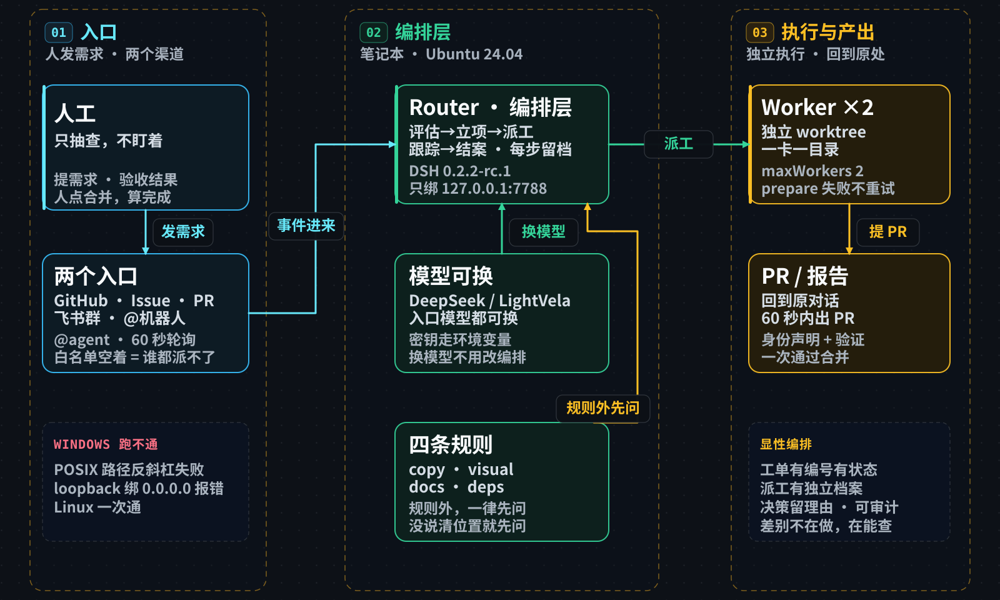

# 在 Ubuntu 上部署 dsh-superagent 并跑通全流程

> super agent 是 DSH 的扩展包，要求 **POSIX 路径 + loopback Web 服务**。
> Windows 上跑不起来，Linux 一次成功。



**上游项目**：<https://github.com/deepseek-ai/dsh-superagent-prototype> —— 本文是对它的实践记录，不是它的文档。

**结构**：部署（1-8）→ 两条通道（9-12）→ 四个案例（11、12 内）→ 结论（13）→ 边界与排障（14-16）。

---

## 一、为什么选 Ubuntu

```
要求 POSIX 路径      Windows 反斜杠直接失败
要求 loopback Web    Windows 上的绑定校验不通过
```

Linux 一次装通，Windows 两条硬门槛都过不了。

## 二、准备 SSH

```bash
sudo apt update && sudo apt install -y openssh-server
sudo systemctl enable --now ssh
sudo ufw status                      # 若 active，再 ufw allow 22/tcp
```

免密：

```bash
mkdir -p ~/.ssh && chmod 700 ~/.ssh
echo '<公钥>' >> ~/.ssh/authorized_keys && chmod 600 ~/.ssh/authorized_keys
```

### 定位 IP 会变的主机

IP 每次开机不同，别写死。两个脚本都在 `furoute/acp-lite` 仓库根目录：

```bash
./lan-find.sh aa:bb:cc:dd:ee:ff              # 知道 MAC，1-2 秒
./host-find.sh <hostname> <ssh-user> 192.168.0  # 只知道主机名，2-11 秒
```

## 三、装基础环境

```bash
sudo apt-get install -y git tmux python3-pip build-essential curl

# GitHub CLI
sudo mkdir -p -m 755 /etc/apt/keyrings
wget -qO- https://cli.github.com/packages/githubcli-archive-keyring.gpg \
  | sudo tee /etc/apt/keyrings/githubcli-archive-keyring.gpg >/dev/null
sudo chmod go+r /etc/apt/keyrings/githubcli-archive-keyring.gpg
echo "deb [arch=$(dpkg --print-architecture) signed-by=/etc/apt/keyrings/githubcli-archive-keyring.gpg] \
https://cli.github.com/packages stable main" \
  | sudo tee /etc/apt/sources.list.d/github-cli.list >/dev/null
sudo apt-get update && sudo apt-get install -y gh

# Node 24
curl -fsSL https://deb.nodesource.com/setup_24.x | sudo -E bash -
sudo apt-get install -y nodejs

# pnpm 用 corepack，比 npm -g 稳
sudo corepack enable pnpm && corepack prepare pnpm@latest --activate
```

版本底线：Node 22.19+/24+、pnpm、git 2.32+、tmux、Python 3.8+、gh 2.48+。

> **坑**：`sudo npm i -g pnpm` 慢且可能装成断链，用 `corepack enable pnpm`。

## 四、装 DSH CLI

```bash
sudo npm install -g @deepseek-ai/dsh@0.2.2-rc.1 --registry=https://registry.npmmirror.com
dsh --version     # 0.2.2-rc.1
```

### API Key 放哪

| 位置 | 结果 |
|:--|:--|
| `~/.dsh/.credentials.yaml` 手工加 | ❌ headless 仍报 MISSING_CREDENTIAL |
| 网页「设置 → 模型」 | 只对 web 服务生效 |
| `.bashrc` 里 export | ✅ CLI 能读到 |

**`.bashrc` 有陷阱**：Ubuntu 默认开头有 `case $- in *i*) ;; *) return;; esac`，
非交互 shell 直接 return。**export 必须写在文件最前面。**

## 五、拉仓库并编译

```bash
mkdir -p ~/projects && cd ~/projects
git clone https://github.com/deepseek-ai/dsh-superagent-prototype.git dsh-superagent
cd dsh-superagent
pnpm install --registry=https://registry.npmmirror.com
pnpm build      # 必须！源码是 TS，没有 lib/ 插件加载不了
```

> `pnpm check` 里两个失败用例是飞书相关（无凭据连不上），与部署无关。

## 六、装进 DSH profile

```bash
dsh plugin --profile web add ./
```

再在 `~/.dsh/profiles/web/cordis.patch.yml` 末尾补：

```yaml
- id: dsh-superagent
  config:
    stateDir: /home/<user>/.dsh/state/superagent
```

## 七、启动：必须绑 127.0.0.1

```bash
dsh --profile web --host 127.0.0.1 --port 7788 --no-open
```

绑 `0.0.0.0` 会直接失败：

```
Error: Orchestrator management requires a loopback Web server
```

源码 `src/app/http.ts:231`：

```ts
if (ctx.webServer.host !== '127.0.0.1')
  throw new Error('Orchestrator management requires a loopback Web server')
```

**有意为之**：它能改代码、能提 PR，暴露到网络等于把遥控器递出去。
远程看面板用 SSH 转发：

```bash
ssh -L 7788:127.0.0.1:7788 <user>@<host>
```

## 八、GitHub 账号与授权

**必须是真实用户账号，不能用 GitHub App** —— 它读的是账号的通知，App 没有这个概念。

```bash
gh auth login          # 用 agent 账号登录，scope 要 repo
gh auth status

# 给 agent 一个独立的 gh 包装
cp -r ~/.config/gh ~/.config/gh-agent
cat > ~/.local/bin/gh-agent <<'EOF'
#!/bin/sh
GH_CONFIG_DIR="$HOME/.config/gh-agent" exec /usr/bin/gh "$@"
EOF
chmod +x ~/.local/bin/gh-agent
gh-agent api user --jq .login
```

建仓库 + 加协作者（agent 身份执行，邀请用自己的账号接受）：

```bash
gh repo create superagent-test --private --add-readme
gh api -X PUT repos/<agent>/superagent-test/collaborators/<you> -f permission=push
```

## 九、配置（走管理 API 比点界面快）

```
http://127.0.0.1:7788/orchestrator/api/
必须带 header:  x-orchestrator-request: 1
```

**Source（监听哪个仓库）**

```python
PUT settings/source:github
{"value": {"enabled": true, "config": {
    "repository": "<agent>/superagent-test",
    "cli": "/home/<user>/.local/bin/gh-agent",
    "observeIssues": true, "observeComments": true, "pollSeconds": 60
}}, "revision": 0}
```

**Policy（白名单）**

```python
PUT settings/policy
{"value": {"rules": [...], "sources": {"github": {"allowed": [{"id": "<you>"}]}}}, "revision": 0}
```

白名单空着 = 谁都派不了活。

**Executor（在哪干活）**

```bash
git clone https://github.com/<agent>/superagent-test.git ~/src/superagent-test
```

```python
PUT settings/executor
{"value": {
    "directory": "/home/<user>/.dsh/state/superagent/work",
    "maxWorkers": 2,
    "blockedCommands": ["dsh", "codex", "claude"],
    "prepare": (
      'git -C /home/<user>/src/superagent-test fetch --no-tags '
      '"https://github.com/$DSH_SUPERAGENT_GITHUB_REPOSITORY.git" '
      '"${DSH_SUPERAGENT_GITHUB_PR_HEAD:-HEAD}:refs/dsh-superagent/$DSH_SUPERAGENT_TICKET" && '
      'git -C /home/<user>/src/superagent-test worktree add -b '
      '"agent/$DSH_SUPERAGENT_NAME" "$DSH_SUPERAGENT_DIR" '
      '"refs/dsh-superagent/$DSH_SUPERAGENT_TICKET"'
    )
}, "revision": 0}
```

**确认就绪**：`GET state` → `setup.problem` 为 null，health 全 ready。

## 十、规则：它什么时候「自己干」

`policy.rules` 决定哪些需求不问直接做。

| id | 范围与约束 |
|:--|:--|
| `copy` | 错别字、措辞、标点、已有翻译 |
| `visual` | 明确的间距/对齐/溢出/样式修复；不构成明确目标就不动 |
| `docs` | 明确指定位置的文档补充；**只加内容**，不改已有代码与措辞；没说清位置就先问 |
| `deps` | 升到**指定版本**或修**指定 CVE**；只改版本号和 lockfile；**必须跑测试，失败就停** |

**规则之外一律先问。** 设计选择，不是缺陷。

---

## 十一、GitHub 通道：三个案例

### 案例一：改一行文案

```
Issue #1  @<agent> 请在 README.md 末尾加一行「hello from superagent」，然后提 PR。
```

60 秒内 → 建分支 → 改文件 → PR #2 → 回帖。

### 案例二：走 docs 规则

```
Issue #3  @<agent> 请在 README.md 里加一节「快速开始」，说明怎么 clone、怎么运行。
```

60 秒内 → PR #4，17 行新增，一次通过合并。

PR 正文四段式（可以直接学）：

```
This is by an automated agent, not a human.      ← 身份声明
## What changed     改了什么
## Verification     git diff --check、代码块配对、文件末尾换行
Requested in #3.                                 ← 来源引用
```

**最值得记的细节**：仓库是空的（只有 README），要求它写「怎么运行」，很容易编。
它没编：

> 本仓库目前只包含 README 文档，没有可执行程序、依赖或构建脚本。

**「不给不存在的命令」是判断 agent 能不能用的第一条标准。**

### 案例三：开放式研究任务

```
Issue #5/@<agent> 研究两个方向，每个结论带可点来源，最后给判断：
  · BGP 的 path attribute TLV 能不能承载 agent 信令
  · 区块链能不能承载 agent 微支付
```

| 尝试 | 开始 | 结果 |
|---|---|---|
| 1 | 02:36:07 | failed（GnuTLS -110，代理未继承） |
| 2 | 02:37:42 | failed（同一个错） |
| 3 | 02:40:37 | **ready**，02:53:57 交付 |

**更正（查源码后）**：`src/executor/dsh.ts` 明确写 **prepare 失败不自动重试**，
标 failed 等人工输入或显式重试。理由是半成品目录会被当成已准备好的工作区。
记录里的 `endedReason: retried` 在源码里是「Retried by a person」，这两次是服务重启后重新排队的，不是它自己判断后重试。

**产出**：

```
work/bgp-payment-research-<hash>/
├── report.md          27 KB，两万多字，三章 + 五层表
├── urls.txt           待抓清单
└── research/          75 份原始资料（RFC、APNIC、x402/AP2、BIS、MiCA、白皮书）
```

结论：**BGP 能塞字节但跑不起来 agent 互联，支付更现实**；43 个链接自述验过 HTTP 200；自写了「研究局限」（没做抓包实测、压测、商户访谈）。

#### 案例三附：私有仓库本身就是白名单

报告贴在私有仓库的 issue 里，于是：

```
已登录的机器     点得开
微信/未登录 curl  404
```

**不是链接坏了。** GitHub 对无权访问私有仓库返回 `404` 而非 `403`，连存在性都不暴露 —— 隐式拒绝。
机制就是**私有仓库 + 协作者名单 = 白名单**，和 ACP-Lite 三区模型「默认拒绝、明确授权才放行」同一思路。

分享私有内容只有三条路：加协作者、搬公开、导出给对方。发链接不加人，一定 404。

---

## 十二、飞书通道：配置与案例四

### 为什么选飞书

```
微信  给 Hermes    钉钉  给 OpenClaw    飞书  给 super agent
```

代码里飞书是一等公民：`feishu-channel` / `feishu-trigger` / `feishu-read` / `feishu-image` / `feishu-loops` 都有实现。

### 第一步：建应用（人来做）

<https://open.feishu.cn/app> 建自建应用，开机器人能力，最小权限：

```
im:message                   收发消息
im:message:send_as_bot       以机器人身份发
im:chat:readonly             读群信息
im:chat.group_info:readonly  读群资料
im:chat.members:read         读群成员（拿 open_id）
```

**改完权限必须「发布版本」**，否则报 `app_scope_not_applied`。这是最容易漏的一步。

App ID / App Secret 是凭据：不贴聊天、不进仓库。本文一律写 `<APP_ID>` / `<APP_SECRET>`。

### 第二步：装 lark-cli

它不直接调飞书 API，而是通过官方 CLI 转发（配置项只有一个：lark-cli 路径）。

```bash
npm install -g @larksuite/cli --prefix ~/.local   # 全局 npm 常没权限
~/.local/bin/lark-cli --version                   # 1.0.99
```

### 第三步：配机器人身份（必须独立配置目录）

```bash
export LARKSUITE_CLI_CONFIG_DIR="$HOME/.lark-cli-dsh-superagent"
lark-cli config init --app-id <APP_ID> --app-secret-stdin   # secret 从 stdin 读
lark-cli config strict-mode bot --global                    # 只许机器人身份
```

**为什么必须独立目录**：一个 App ID 只允许一个本地 profile，你个人的登录会冲突。
super agent 也拒绝一个能当用户的 CLI。

包装脚本：

```bash
cat > ~/.local/bin/lark-bot <<'EOF'
#!/bin/sh
export LARKSUITE_CLI_CONFIG_DIR="$HOME/.lark-cli-dsh-superagent"
exec lark-cli "$@"
EOF
chmod +x ~/.local/bin/lark-bot
lark-bot auth status     # "bot": { "status": "ready" }
```

### 第四步：把机器人拉进群

群设置 → 群机器人 → 添加应用。然后：

```bash
lark-bot im +chat-list   # 拿到 chat_id（oc_ 开头）
```

### 第五步：启用源（最容易卡住）

**飞书源在上游 bundle 里默认 `disabled: true`**，所以刚装好时面板里只有 GitHub，

也没有「添加来源」按钮。

```yaml
# ~/.dsh/profiles/web/cordis.patch.yml
- id: dsh-superagent-feishu
  disabled: false
```

重启后飞书出现在来源列表，但状态是 `paused`：

```json
{"state":"paused","detail":"The Source is on, and its bot lark-cli is not set","code":"feishuCliUnset"}
```

### 第六步：面板填配置

**这个字段没有写接口**（`settings/source:feishu` 的 PUT 返回 404），只能界面填：

| 字段 | 填什么 |
|---|---|
| 机器人的 lark-cli | `/home/<user>/.local/bin/lark-bot`（绝对路径） |
| 能发起工作的飞书用户 | 你的 `open_id`（`ou_` 开头） |
| 群 | 测试群 `chat_id`（`oc_` 开头），接收方式「全部消息」 |
| 私聊 | 开 |
| 其他群 | 「仅 @」 |

保存后自动重启检查。变 `ready` / `Listening for bot events` 就通了。

### 第七步：评估模式切 auto

```
off       完全关掉评估
observe   只看不派（默认）
auto      判断该接就建工单派 worker
```

```bash
PUT orchestrator/api/settings/eval
{"value": {"mode": "auto", "timeoutSeconds": 120, "model": null}, "revision": <当前>}
```

### 第八步：测试

**配置变更只对新消息生效，旧的被过滤消息不重放**，改完必须重发。

```
闲聊   @<机器人> 只回复三个字：收到了
       → 回复「收到了」，不建工单（正确）

可执行 @<机器人> 请在 README.md 末尾加一行：Feishu test passed
       → 建工单 → 派 worker → 提 PR #8 → 群里回报 → 合并后再发一条合并通知
       发消息到 PR 约 90 秒，到合并通知约 4 分钟，全程人未介入
```

**反向验证**：群里问「某游戏战况」，它会联网查并回答，但不建工单 —— 查询不属四类规则。

### 踩过的坑

| 现象 | 原因 | 处理 |
|---|---|---|
| 面板里没有飞书，也没有「添加」按钮 | 上游默认 `disabled: true` | profile patch 覆盖 |
| `app_scope_not_applied` | 权限申请了但没发布版本 | 开放平台点发布 |
| `lark-cli is not set` | `cli` 字段为空 | 面板填绝对路径 |
| `chat_not_allowed` | 群不在允许清单 | 面板加该群 `chat_id` |
| 机器人看不见群 | 没拉进群 | 群设置里添加 |
| `mode: act` Invalid option | 只有 off / observe / auto | 用 `auto` |
| 改完配置测试没反应 | 旧消息不重放 | 重新发一条 |

### 案例四：飞书下题 + 换模型

**入口换飞书群，模型换成第三方 OpenAI 兼容网关（LightVela）。**

```
@<机器人> 看看笔记本「下载」目录的 .md，结合这个仓库文档：
https://github.com/.../docs/DSH-Superagent-Ubuntu-deployment-and-tests.md
讨论分析如何「解放人的注意力」，不写代码，只提构想。
```

**第一次它拒了**，判定 `ignore`：

```
请求是阅读本地 .md 与仓库文档后做开放式讨论与构想，不是文案纠错、样式修复、
带明确目标的文档新增或依赖升级，不符合任何已启用规则。
```

**⇒ 评估层在正确工作**：开放式研究不在四类规则里，它没硬凑，而是说了理由。

转成「产出文档」后按 `docs` 规则接单。

**模型切换**（profile 里加 OpenAI 兼容网关路由，密钥走环境变量）：

```yaml
- insert:
    - id: llm-pi-ai
      name: '@deepseek-ai/dsh-llm-pi-ai'
      config:
        providers:
          lightvela:
            apiKeyEnv: LIGHTVELA_API_KEY
            baseURL: https://<endpoint>/v1
```

```
routableProviders   deepseek-official, lightvela
default             provider=lightvela, model=auto
```

> **坑**：patch 层只认「改已存在条目」，新插件必须包在 `insert:` 列表里；
> 且 worker 子进程不继承父进程环境，密钥要在启动命令里显式 export。

**它怎么干的**（会话日志）：

```
orchestrator_ack → orchestrator_read（读 trigger）→ bash（ls 下载目录）
→ read ×2（读两份 md）→ write（写报告）→ edit（校准一处引用）
→ orchestrator_report
共 25 次工具调用，没绕远路
```

**产出**：13 KB、七章 —— 算账表（八个环节逐项标「已解放/未解放/有意保留」）、
三个解放机理、四个注意力黑洞、哪些不该解放、L0-L2 分层、落地优先级。

结论一句：**过程性注意力已解放，运维性与兜底性是当前黑洞，判断性注意力被设计保留给人。**

---

## 十三、四个案例的结论

### 和普通 DSH 的区别

| | 普通 DSH | super agent |
|---|---|---|
| 触发 | 你发一条消息 | 事件进来，它判断接不接 |
| 形态 | 做一轮 → 结束（无痕） | 立项 → 派工 → 跟踪 → 结案 |
| 人在哪 | 始终在回路里 | 可以不看，抽查即可 |
| 记录 | 对话即全部 | 工单 / 派工 / 决策 / 结案都留档 |

### 五个案例横向对照

| | 案例一 改一行 | 案例二 加一节 | 案例三 研究 | 案例四 飞书+换模型 |
|---|---|---|---|---|
| 入口 | GitHub | GitHub | GitHub | **飞书** |
| 模型 | DeepSeek | DeepSeek | DeepSeek | **LightVela** |
| 谁规划 | 它 | 它 | 它，含章节结构 | 它 |
| 谁找料 | 仓库内 | 仓库内 | **75 份一手资料** | 读本地 + 仓库 |
| 人介入 | 0 | 0 | 只在环境层面 | 0 |
| 产出 | 1 行 | 1 节 | 27 KB 报告 | 13 KB 分析 |

**⇒ 模型和入口都是可替换件，编排层才是它自己的东西。**

### 不能少的那五步

| 步骤 | 做了什么 | 少了会怎样 |
|---|---|---|
| **评估** | 先判断该不该接，记下理由和策略版本 | 什么都接，疲于奔命 |
| **立项** | 生成不可变的授权书（who / 范围 / 依据） | 干着干着范围越做越大 |
| **派工** | 每次执行独立成档：谁干、干成没、为什么结束 | 出错查不出是哪一轮 |
| **跟踪** | 绑上自己开的 PR、引用的 issue，没关完不算完 | 提完就不管了 |
| **结案** | 记录谁结的、什么结论、什么原因 | 无从复盘 |

**这五步是「项目制」的骨架，也是可审计、可追责的前提。**

### 它借了 GitHub 的五样基础设施

```
身份（账号）· 事件源（通知/issue）· 协作界面（评论）
变更记录（commit/PR）· 权限（仓库白名单）
```

自己搭要半年，借来免费还自带审计。它只补了 GitHub 没有的那层：**谁该接、接几个、什么时候算完**。
「媒介」是借的，「编排」是自己的 —— 和 ACP-Lite 借 Syncthing 当邮局同一思路。

### 真正稀缺的是「显性」

Claude Code 这类工具内部也有派单、多步执行，但藏在对话里：看不到派工记录、看不到决策依据、只能等它说。

这里把同样的东西摆到台面上：工单有编号有状态、派工有独立档案、决策有理由、健康有八维。

**差别不在能不能做，在能不能查。**
隐性编排让 agent 更顺手，显性编排让 agent 可以被管。

### 能不能移植

```
保留   工单 / 派单 / 授权 / 跟踪 / 结案      ← 与平台无关
替换   事件源、身份、协作界面、变更记录      ← 与平台绑定
```

落地顺序：**先把项目制建起来，再选承载平台**。

```
研发场景   Gitee / GitCode（接口像 GitHub，改动最小）
业务场景   飞书多维表格 + 审批（工单=记录，派单=审批，结案=状态流转）
```

**最容易被低估的是执行器**：现在它只会写代码，规则也只认那四类；换业务场景，规则和执行器都得重写。

### 显性不是免费的

为了让事情可查，留下的记录比事情本身还多 —— 每次执行要落盘、要维护工单状态、要写决策理由。

```
super agent   每次执行一份 assignment 档案
ACP-Lite      每条消息签名 + 审计链
```

⇒ 数据量小时可接受；agent 数量上来后，**记录本身会变成新瓶颈**。
知道这笔账存在，比事后惊讶好。

---

## 十四、边界

**能**：入口 GitHub（Issues/PR/评论/CI）+ 飞书；独立 worktree 里改代码、跑命令、提 PR、回帖；面板看工单、负载、来源统计。

**不能**：接 GitHub / 飞书之外的入口（要照 `docs/008-cookbook.md` 写新 Source）；做规则外的设计判断（会先问）；跑在非 loopback 上。

## 十五、排障速查

| 现象 | 原因 | 处理 |
|:--|:--|:--|
| `requires a loopback Web server` | bind 到非 127.0.0.1 | 用 `--host 127.0.0.1` |
| `Cannot find module '.../lib/index.js'` | 没跑 `pnpm build` | `pnpm build` 后重启 |
| `MISSING_CREDENTIAL` | key 只在 web 服务内存里 | 环境变量或 profile 补丁层 |
| 面板「来源名单为空」 | `policy.sources.*.allowed` 空 | 填白名单 |
| 「GitHub 未设置监听仓库」 | `repository` 空 | 填 `owner/name` |
| `no pnpm` / `ENOENT: pnpm` | pnpm 断链 | `corepack enable pnpm` |
| 提了 issue 没反应 | 没 @，或不在白名单 | 评论里 @ 一次；查 allowed |
| 新插件不生效 | patch 层不认顶层新条目 | 包进 `insert:` 列表 |
| worker 拿不到环境变量 | 子进程不继承 | 启动命令里显式 export |
| 调 `codex` 后一直没输出 | 无终端时它在等 stdin | 命令末尾加 `< NUL` |
| 改了配置测不出效果 | 旧消息不重放、旧进程不读新配置 | 重启服务 + 重发消息 |

## 十六、重启后自恢复

### 坑 1：gh token 存在桌面钥匙串里

```
The token in default is invalid.
```

`hosts.yml` 里只有用户名，token 在 `gnome-keyring`。桌面没登录 → 钥匙串没锁开 → SSH 会话读不到。

修法：token 明文写进 `hosts.yml`（权限 600），绕开 keyring。代价是磁盘明文，换来不依赖桌面登录。

### 坑 2：`~/.local/bin` 不在 SSH 的 PATH

```
gh-agent: 未找到命令
```

写进 `.bashrc` 最前面（同 API Key，必须在非交互 return 之前）：

```bash
export PATH="$HOME/.local/bin:$PATH"
```

### 重启后自检

```bash
uptime -p
gh auth status
bash -c 'source ~/.bashrc; which gh-agent'
bash -c 'dsh --profile web --host 127.0.0.1 --port 7788 --no-open'
# GET /orchestrator/api/state → setup.problem 为 null，health 全 ready
```

### 开机自启：先算「税」再决定

每次开机手动三步：

```bash
python3 find_laptop.py
ssh <user>@<ip>
dsh --profile web --host 127.0.0.1 --port 7788 --no-open
```

这是**固定税**——每天必交，确定性支出。而失败兜底、验收、写实录都是**偶发税**，出事了才交。

**固定税永远优先于偶发税。**

当初决定「不做自启」的理由是「多一个常驻配置，重装系统容易忘」。
这个判断把成本高估了：**user 级 systemd 服务只是一个随手能删的文件**，不是新的系统组件。

⇒ 结论：值得上 user 级 systemd，起来后自动跑自检，并把健康摘要发到群里。
人从「起服务 + 做五项检查」降为「看一条自报」。

---

## 附：版本基线

```
OS         Ubuntu 24.04（内核 7.x）
Node       24.22.2
pnpm       12.18.0
git        2.43.0
Python     3.12.3
gh         2.103.3
DSH CLI    0.2.2-rc.1
lark-cli   1.0.99
Web 端口    127.0.0.1:7788
```
